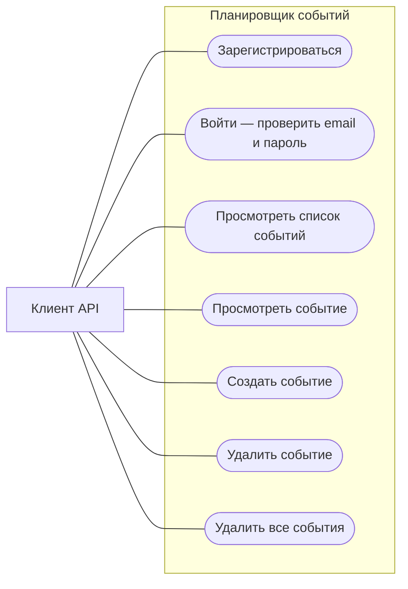

# Варианты использования планировщика

Диаграмма описывает реализованный API практической работы №7. Актор «Клиент API»
использует Swagger UI, curl или HTTP-клиент. Регистрация и вход не являются
предусловиями операций с событиями: механизм сессий в этой работе отсутствует.

## Диаграмма

Mermaid изображает варианты использования овальными узлами внутри границы системы.

## Основные сценарии

### 1. Регистрация

Предусловие: email ещё не зарегистрирован.

1. Клиент отправляет email и непустой пароль в `POST /user/signup`.
2. Система проверяет формат данных и отсутствие email в словаре пользователей.
3. Система сохраняет пользователя и возвращает 200 с сообщением об успешной регистрации.

Результат: пользователь доступен для проверки входа. Если список событий не передан,
он пуст. Повторный email возвращает 409, неверный формат email — 422.

### 2. Вход

Предусловие: пользователь зарегистрирован.

1. Клиент отправляет email и пароль в `POST /user/signin`.
2. Система находит пользователя и сравнивает пароль.
3. Система возвращает 200 с сообщением об успешном входе.

Результат: данные входа подтверждены. Сессия или токен не создаются.
Неизвестный email возвращает 404, неверный пароль — 403.

### 3. Просмотр списка событий

Предусловий нет.

1. Клиент отправляет `GET /event/`.
2. Система возвращает 200 и массив событий со всеми полями модели `Event`.

Результат: клиент получает текущий список; при отсутствии событий возвращается `[]`.

### 4. Просмотр одного события

Предусловие: существует событие с указанным ID.

1. Клиент отправляет `GET /event/{id}`.
2. Система находит событие по ID.
3. Система возвращает 200 и объект события.

Результат: получены данные события. Неизвестный ID возвращает 404,
нецелочисленный ID — 422.

### 5. Создание события

Предусловие: выбранный положительный ID ещё не занят.

1. Клиент отправляет в `POST /event/new` поля `id`, `title`, `image`,
   `description`, `tags` и `location`.
2. Система проверяет модель и уникальность ID.
3. Система добавляет событие и возвращает 200 с сообщением о создании.

Результат: событие доступно в списке и по ID. Повторный ID возвращает 409;
отсутствующее обязательное поле или неверный тип — 422.

### 6. Удаление события

Предусловие: существует событие с указанным ID.

1. Клиент отправляет `DELETE /event/{id}`.
2. Система удаляет найденное событие.
3. Система возвращает 200 с сообщением об удалении.

Результат: событие больше не доступно. Неизвестный ID, включая повторное удаление,
возвращает 404.

### 7. Удаление всех событий

Предусловий нет.

1. Клиент отправляет `DELETE /event/`.
2. Система очищает список событий.
3. Система возвращает 200 с сообщением об удалении всех событий.

Результат: список событий пуст. Для уже пустого списка операция также успешна.

## Дальнейшее развитие по методичке

Связь владельца с событиями, разграничение доступа, выход, обновление события
и постоянное хранение не включены в диаграмму текущего API: соответствующие
механизмы отсутствуют в примерах этой работы.
